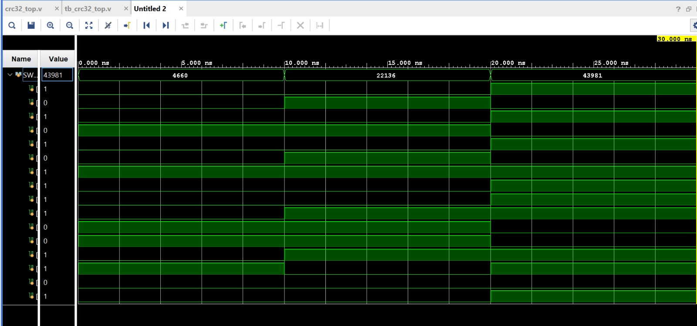

# CRC-32 Implementation Using Verilog HDL on FPGA


## 📌 Project Overview

This project demonstrates the implementation and behavioral simulation of a **CRC-32 calculation module using Verilog HDL** in **AMD Xilinx Vivado 2024.1**.

CRC (Cyclic Redundancy Check) is an error-detection technique used to identify accidental changes in digital data during transmission or storage.

The current implementation accepts a **16-bit input**, processes it using CRC polynomial logic, and calculates a **32-bit internal CRC state**. The lower 16 bits of the result are connected to the output bus for observation.

The project targets the **Digilent Nexys 4 DDR FPGA development board**, which uses the Xilinx Artix-7 FPGA.


---

## 🎯 Objectives

- Design CRC calculation logic using Verilog HDL.
- Use the CRC-32 polynomial `0x04C11DB7`.
- Process 16-bit input data.
- Generate a 32-bit internal CRC state.
- Observe the lower 16 bits of the CRC result.
- Develop a Verilog testbench for simulation.
- Analyze simulation waveforms in Vivado.
- Verify that the testbench executes multiple input cases.

---

## 🛠️ Tools and Technologies

| Component | Description |
|---|---|
| Hardware Description Language | Verilog HDL |
| Development Tool | AMD Xilinx Vivado 2024.1 |
| Simulation Tool | Vivado XSim |
| Target FPGA Board | Digilent Nexys 4 DDR |
| FPGA Family | Xilinx Artix-7 |
| FPGA Part | `xc7a100tcsg324-1` |
| CRC Polynomial | `0x04C11DB7` |
| Input Width | 16 bits |
| Internal CRC Width | 32 bits |
| Displayed Output Width | 16 bits |

---

## 📁 Project Structure

```text
fpga_project/
│
├── crc32_top.v
├── tb_crc32_top.v
├── README.md
│
└── screenshots/
    ├── 868488e2-5320-493c-b85a-ebbbb9cd512a.jpg
    ├── a05e312d-c18a-4931-805c-d960a23e685c.jpg
    └── a9d5a31f-3556-4f34-953c-4f4b639b8a00.jpg
```

### File Descriptions

**`crc32_top.v`**

The main Verilog module that performs CRC calculation using shift and XOR operations.

**`tb_crc32_top.v`**

The Verilog testbench that applies different input values, waits between test cases, and displays the corresponding results.

**`screenshots/`**

Contains two behavioral simulation waveform screenshots and one Tcl Console output screenshot.

---

## ⚙️ Working Principle

The CRC calculation follows these steps:

1. A 16-bit input is applied through `SW[15:0]`.
2. The internal CRC state is initialized to `32'hFFFFFFFF`.
3. The input bits are processed from the most significant bit to the least significant bit.
4. For each input bit, the CRC state is shifted left.
5. Polynomial XOR feedback is applied when required using `32'h04C11DB7`.
6. After processing all 16 input bits, the calculated CRC state is available.
7. The lower 16 bits of the CRC state are assigned to `LED[15:0]`.

### Simplified Block Diagram

```text
       16-bit Input Data
           SW[15:0]
               |
               v
    +----------------------+
    |  CRC-32 Calculation  |
    |                      |
    | Initial: FFFFFFFF    |
    | Polynomial: 04C11DB7 |
    | Shift and XOR Logic  |
    +----------------------+
               |
               v
       32-bit CRC State
               |
               v
       Lower 16 Bits
          LED[15:0]
```

The current design uses **combinational logic**, so its output is recalculated whenever the input changes.

---

## 🧪 Behavioral Simulation

The design was simulated using **Vivado XSim**.

The testbench applies three input patterns:

- `16'h1234`
- `16'h5678`
- `16'hABCD`

Each input is held for 10 ns before the next test case.

The simulation runs from **0 ns to 30 ns**, after which the testbench terminates using `$finish`.

### Simulation Test Cases

| Test Case | Simulation Time | Input (`SW`) | Output (`LED[15:0]`) |
|---|---|---|---|
| 1 | 0–10 ns | `1234` | `7A2D` |
| 2 | 10–20 ns | `5678` | `DCDB` |
| 3 | 20–30 ns | `ABCD` | `8008` |

These are the output values reported by the current Vivado simulation. They represent the **lower 16 bits of the internal CRC state**, not the complete 32-bit CRC.

---

## 📊 Simulation Results and Screenshots

### 1. Behavioral Simulation Waveform — Part 1

The first waveform screenshot shows the input signals and their transitions during simulation.

The input values change at approximately 0 ns, 10 ns, and 20 ns.



### 2. Behavioral Simulation Waveform — Part 2

The waveform viewer was scrollable, so a second screenshot was captured to show the remaining output signals.

Together, these two screenshots provide a more complete view of the simulated input and output signals.


### 3. Vivado Tcl Console Output

The Tcl Console shows the messages printed by the Verilog testbench.

The following output was observed:

```text
Starting CRC-32 testbench

Input = 1234, CRC lower 16 bits = 7a2d
Input = 5678, CRC lower 16 bits = dcdb
Input = abcd, CRC lower 16 bits = 8008

$finish called at time : 30 ns
```

The simulation completed successfully without a fatal simulation error.


---

## 🔍 Simulation Analysis

The simulation demonstrates the following behavior:

1. **Input Response:** Different input patterns produce different output values.
2. **Combinational Operation:** The output is recalculated when the input changes.
3. **Testbench Execution:** All three input patterns were applied successfully.
4. **Waveform Observation:** The signal transitions can be inspected using Vivado's waveform viewer.
5. **Console Output:** The testbench prints the calculated lower 16-bit output for each test case.
6. **Simulation Completion:** The testbench reaches `$finish` at 30 ns.

### Verification Limitation

Successful simulation confirms that the Verilog code compiles and the testbench executes.

However, independent verification against a reference CRC model is still required to establish the correctness of the complete 32-bit CRC result.

CRC compatibility depends on parameters such as:

- Polynomial
- Initial CRC value
- Input bit order
- Input/output reflection
- Final XOR value

---

## 🚀 How to Run the Project

### Prerequisites

- AMD Xilinx Vivado with XSim support
- Verilog source files from this repository

### Steps

1. Open Vivado.
2. Create a new RTL project.
3. Select the FPGA part `xc7a100tcsg324-1`.
4. Add `crc32_top.v` as a design source.
5. Add `tb_crc32_top.v` as a simulation source.
6. Set `tb_crc32_top` as the simulation top module.
7. Click **Run Simulation → Run Behavioral Simulation**.
8. Observe the `SW` and `LED` signals in the waveform viewer.
9. Open the Tcl Console to inspect the printed simulation results.

---

## 🌐 Applications

CRC-based error detection is widely used in:

- Digital communication systems
- Ethernet networking
- Data transmission protocols
- Data storage systems
- Embedded systems
- FPGA-based data processing

---

## 📈 Project Status

| Task | Status |
|---|---|
| Verilog design module | Completed |
| Verilog testbench | Completed |
| Vivado project creation | Completed |
| Behavioral simulation | Completed |
| Waveform capture | Completed |
| Tcl Console output capture | Completed |
| Independent full 32-bit CRC verification | Pending |
| FPGA synthesis | Pending |
| FPGA implementation | Pending |
| Physical board testing | Pending |

---

## 🔮 Future Scope

Future improvements include:

1. Verifying the complete 32-bit CRC against an independent reference model.
2. Supporting longer input data streams.
3. Implementing the high-speed CRC architecture described in the reference paper.
4. Evaluating hardware resource utilization and timing performance.
5. Completing FPGA synthesis and implementation.
6. Testing the design on the Nexys 4 DDR FPGA board.

---

## 📚 Reference

**A High-Speed CRC-32 Implementation on FPGA**

This paper provides the research direction for exploring faster FPGA-based CRC calculation architectures.

The current repository contains an initial CRC calculation implementation and behavioral simulation, rather than a complete reproduction of the paper's architecture.

---

## 👨‍💻 Author

**Harsha**

GitHub: [@harshabs07](https://github.com/harshabs07)

---

⭐ If you find this project useful, consider starring the repository!
