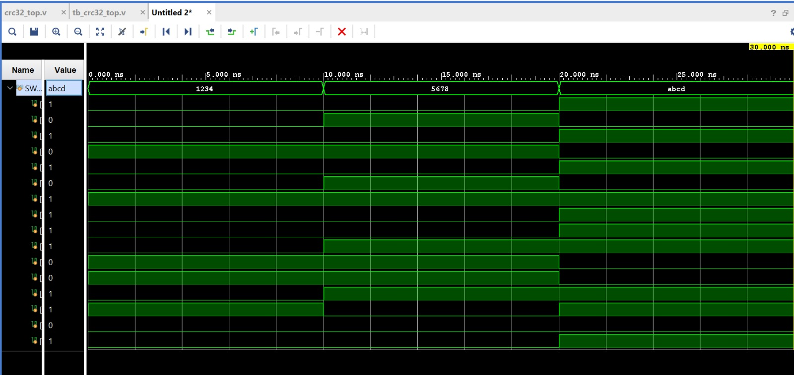
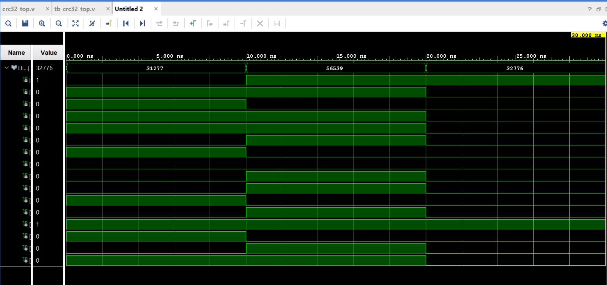
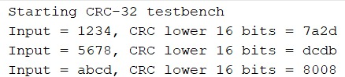

# CRC-32 Implementation Using Verilog HDL on FPGA

## Project Overview

This project implements a basic CRC-32 calculation module using Verilog HDL and simulates it using AMD Xilinx Vivado 2024.1.

CRC (Cyclic Redundancy Check) is an error-detection technique used to detect accidental changes in digital data during transmission or storage.

The idea for this project was inspired by the research paper **"A High-Speed CRC-32 Implementation on FPGA."** I referred to this paper to understand FPGA-based CRC-32 implementation and use it as a starting point for my project.

## Tools and Technologies

- Verilog HDL
- AMD Xilinx Vivado 2024.1
- Vivado XSim behavioral simulator
- Target board: Digilent Nexys 4 DDR
- FPGA: Artix-7 XC7A100T-1CSG324C

## Project Files

- `crc32_top.v` — Main CRC calculation module.
- `tb_crc32_top.v` — Testbench used to apply inputs and observe outputs.
- `A_high-speed_CRC-32_Implementation_on_FPGA.pdf` — Reference research paper.
- `screenshots/` — Simulation waveform and console screenshots.

## Working Principle

The design accepts a 16-bit input and calculates a 32-bit internal CRC state.

- Initial CRC state: `0xFFFFFFFF`
- CRC polynomial: `0x04C11DB7`
- Calculation: Shift and XOR operations
- Output: Lower 16 bits of the calculated CRC state

The current design is combinational, so the output is recalculated when the input changes.

## Simulation Results

The testbench applies three input values in Vivado:

| Input (`SW`) | Reported Output (`LED[15:0]`) |
|---|---|
| `1234` | `7A2D` |
| `5678` | `DCDB` |
| `ABCD` | `8008` |

These are the lower 16-bit outputs reported by the current simulation. Full 32-bit CRC verification against a reference implementation is still pending.

## Simulation Screenshots

### 1. Behavioral Simulation Waveform — Part 1

### 2. Behavioral Simulation Waveform — Part 2

### 3. Tcl Console Output

## Reference Research Paper

**Title:** A High-Speed CRC-32 Implementation on FPGA

I referred to this paper for the project idea and background on CRC-32 implementation in FPGA hardware.

[View the reference paper (PDF)](A_High_Speed_CRC32_Implementation.pdf)

## Current Status

- [x] Verilog module created
- [x] Testbench created
- [x] Behavioral simulation completed
- [x] Waveform and console screenshots captured
- [ ] Full 32-bit CRC verification
- [ ] High-speed architecture implementation
- [ ] FPGA synthesis and board testing

## Future Work

- Verify the complete 32-bit CRC results.
- Implement the high-speed architecture described in the reference paper.
- Synthesize and test the design on the Nexys 4 DDR FPGA board.

## Author

Harsha — [GitHub Profile](https://github.com/harshabs07)
